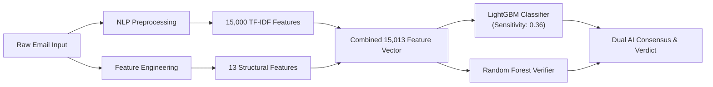

# 🛡️ PhishGuard — AI-Powered Phishing Email Detection System

An enterprise-ready, dual-engine machine learning and full-stack web application designed to protect everyday users and organizations from phishing scams, email fraud, and deceptive links.

Built with a high-performance **Django REST Framework (DRF)** backend and a smooth, modern **React 19 + Vite** frontend.

---

## 🌟 Key Highlights

* **Dual AI Verification Engines**: Combines **LightGBM** (primary pattern detector) and **Random Forest** (structural verifier) operating across **15,013 features** (15,000 TF-IDF text features + 13 structural & link features).
* **High Catch Rate (99.4%)**: Tuned with a cost-sensitive decision threshold (`0.36`) to aggressively eliminate missed phishing threats while maintaining a low false-alarm rate.
* **Non-Developer Friendly Language**: All technical jargon (TF-IDF, entropy, vectorizers, confusion matrices) is explained in clear, intuitive English that any everyday user can understand.
* **Interactive Cyber UI**:
  * **Collapsible & Expandable Sidebar**: Toggle between a full 256px navigation bar and a compact 72px icon dock with smooth animations and persistent local storage.
  * **Aurora Ambient Mesh**: Subtle visual color blending with modern glow accents.
  * **Animated Cyber Scanner**: Real-time holographic radar ripples and live scanning steps when analyzing emails.
  * **Zero Clutter**: Cleaned result display highlighting safety verdicts, risk score meters, consensus badges, and threat checklists.
* **Scan History & Privacy First**: Save and review past email checks with search and filter capabilities, or run private one-off checks with zero data retention.

---

## 🏗️ Project Architecture

```text
Phishing-email-detection/
├── Backend/                            # Django REST Framework API
│   ├── manage.py                       # Django CLI runner
│   ├── requirements.txt                # Python dependencies (Django, DRF, LightGBM, scikit-learn, etc.)
│   ├── db.sqlite3                      # Local database storing scan history
│   ├── phishing_backend/               # Core Django project settings & URL configuration
│   ├── api/                            # REST API application
│   │   ├── views.py                    # Standardized Function-Based Views (FBVs)
│   │   ├── ml_service.py               # Singleton model loader and inference engine
│   │   ├── preprocessor.py             # NLTK tokenization, HTML stripping, & Porter stemming
│   │   ├── features.py                 # 13 structural link/header features & Shannon entropy
│   │   ├── evaluation.py               # Live benchmark test runner & confusion matrix generator
│   │   ├── models.py                   # PredictionRecord database model
│   │   └── serializers.py              # Input validation and response serializers
│   ├── models/                         # Serialized ML models & configuration
│   │   ├── lightgbm_model.pkl          # Primary LightGBM classifier
│   │   ├── random_forest.pkl           # Secondary Random Forest verifier
│   │   ├── tfidf_vectoriser.pkl        # 15,000-vocabulary TF-IDF vectorizer
│   │   └── threshold.json              # Optimal decision threshold config
│   └── data/                           # Dataset storage (processed & raw archives)
│
├── Frontend/                           # React 19 + Vite Single Page Application
│   ├── package.json                    # Node dependencies (React 19, Lucide, React Router, Vite)
│   ├── vite.config.js                  # Vite bundler configuration
│   ├── index.html                      # HTML entry point with Inter font
│   └── src/
│       ├── components/
│       │   ├── analysis/               # Email analysis form, verdicts, loading scanner, signals
│       │   ├── history/                # History table, search, and filtering toolbar
│       │   ├── intelligence/           # AI accuracy stats, dataset splits, & test results
│       │   ├── layout/                 # Collapsible AppShell, navigation, headers
│       │   └── ui/                     # Tactile buttons, badges, risk meters, alerts, dialogs
│       ├── pages/                      # AnalyzePage, HistoryPage, HistoryDetailPage, IntelligencePage
│       └── styles/                     # Design tokens, aurora mesh, button effects, animations
│
├── .gitignore                          # Root ignore rules for Python, Node, Vite, OS, and envs
└── README.md                           # Master project documentation
```

---

## 🚀 Quick Start Guide

### Prerequisites
* **Python**: 3.10, 3.11, or 3.12
* **Node.js**: 18.x or newer (with `npm`)

---

### 1. Backend Setup (Django API)

1. Open a terminal and navigate to the `Backend` directory:
   ```bash
   cd Backend
   ```

2. Create and activate a Python virtual environment:
   * **Windows (PowerShell)**:
     ```powershell
     python -m venv venv
     .\venv\Scripts\Activate.ps1
     ```
   * **macOS / Linux**:
     ```bash
     python3 -m venv venv
     source venv/bin/activate
     ```

3. Install all required dependencies:
   ```bash
   pip install -r requirements.txt
   ```

4. Run database migrations:
   ```bash
   python manage.py migrate
   ```

5. Start the Django development server:
   ```bash
   python manage.py runserver 127.0.0.1:8000
   ```
   The backend API will now be running at `http://127.0.0.1:8000/`.

---

### 2. Frontend Setup (React 19 + Vite)

1. Open a new terminal and navigate to the `Frontend` directory:
   ```bash
   cd Frontend
   ```

2. Install npm dependencies:
   ```bash
   npm install
   ```

3. Start the Vite development server:
   ```bash
   npm run dev
   ```
   Open your browser at `http://localhost:5173/` (or the URL shown in your terminal).

4. *(Optional)* Build for production:
   ```bash
   npm run build
   ```

---

## 📡 REST API Endpoints

All responses follow a uniform JSON envelope standard:
* **Success**: `{ "error": false, "data": { ... }, "message": "...", "statuscode": 200 }`
* **Error**: `{ "error": true, "message": "...", "statuscode": 400 | 404 | 500 }`

| Method | Endpoint | Description |
| :--- | :--- | :--- |
| `POST` | `/api/predict/` | Analyze an email for phishing threats and deceptive links. |
| `GET` | `/api/history/` | Retrieve paginated and searchable scan history. |
| `GET` | `/api/history/<id>/` | Fetch details of a specific saved scan record. |
| `DELETE` | `/api/history/<id>/` | Permanently delete a saved scan record. |
| `GET` | `/api/models/info/` | Get engine health, active models in memory, and feature counts. |
| `GET` | `/api/models/evaluate/` | Retrieve the cached AI benchmark test results on 12,969 emails. |
| `POST` | `/api/models/evaluate/` | Trigger a live evaluation run against the benchmark test split. |
| `GET` | `/api/dataset/summary/` | Get statistics on the 86,456-email training and validation corpus. |

---

## 🧠 Machine Learning Engine



### Extracted Safety Signals
1. **Link Analysis**: Total link count, longest link, hidden raw IP addresses (`http://192.168.1.1/login`), URL shorteners (e.g. `bit.ly`), suspicious TLDs (`.tk`, `.click`), and link Shannon entropy.
2. **Sender Authenticity**: Header mismatch detection between the `From` domain and the hidden `Reply-To` address.
3. **Psychological Panic Patterns**: Detection of urgency keywords (`urgent`, `suspended`, `immediate`, `action required`) in subject and message body.
4. **Formatting Style**: HTML layout tags vs. plain text, character count, word density, and uppercase capital letter ratio.

---

## 🎨 Modern UI & Accessibility Features

* **Sidebar Expand / Collapse**: Smooth toggle button shrinks the navigation bar to an unobtrusive icon dock or expands it to full width.
* **Holographic Scan Animation**: Live radar pulse effect when checking emails with 3 real-time verification indicators.
* **Plain English Descriptions**: Replaced cryptic developer metrics with human-understandable guidance (e.g. "Threat Alert Trigger Point", "False Alarm Prevention", "AI Consensus").
* **Tactile Interactions**: Shimmer light-sweep effect on buttons, smooth lift on hover (`translateY(-2px)`), and gentle tactile click response.

---

## 🧪 Testing

Run backend tests and system check:
```bash
cd Backend
python manage.py check
python manage.py test api
```

Run frontend production build verification:
```bash
cd Frontend
npm run build
```

---

## 📄 License
This project is developed for educational and security research purposes. All rights reserved.

